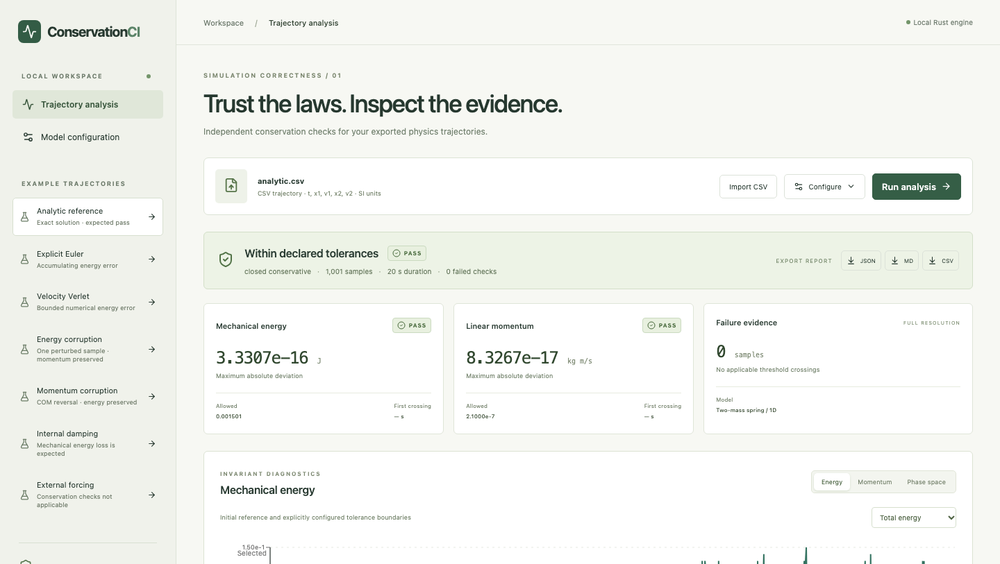
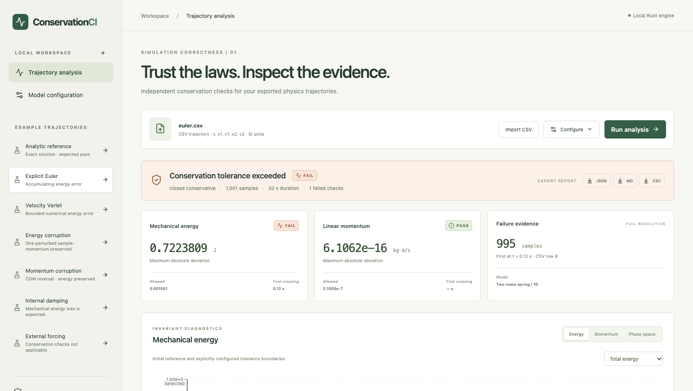
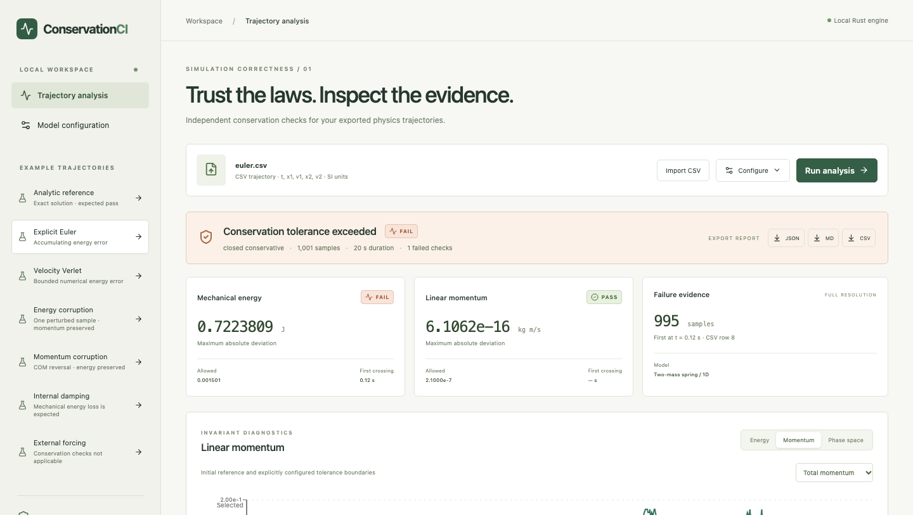
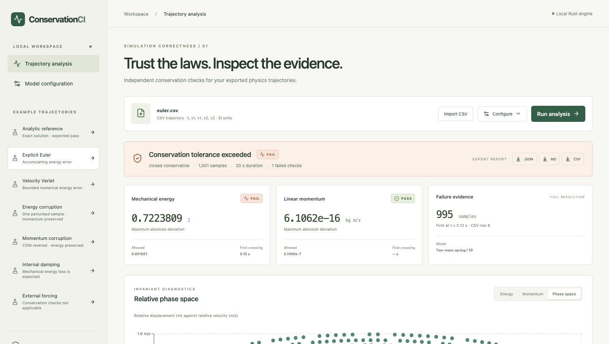
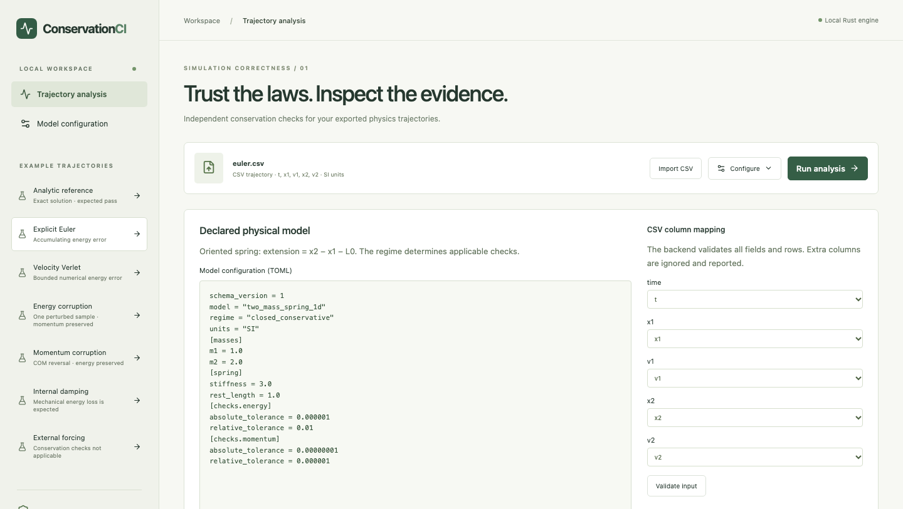
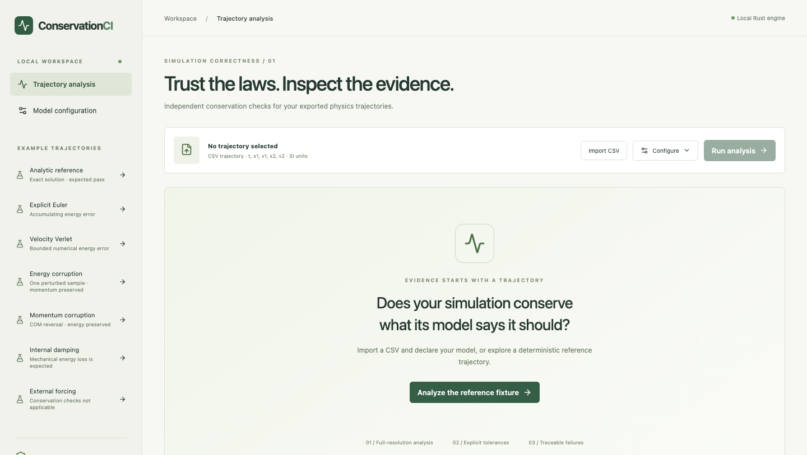
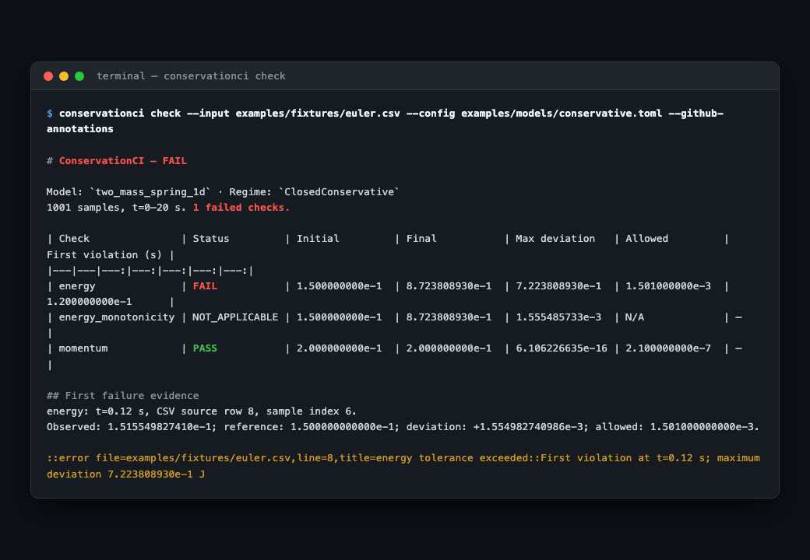

# ConservationCI

**Catch broken physics before it ships.**

ConservationCI independently audits exported simulation trajectories against model-specific conservation expectations, configured tolerances, and traceable evidence. It includes a high-performance Rust engine and CLI, a local HTTP API, and an interactive React dashboard.



## What it catches

An exported trajectory can look plausible while its total energy drifts or its momentum violates conservation laws. ConservationCI evaluates **every sample**, pinpoints the first threshold crossing and exact source CSV row, and exports reproducible evidence for debugging and automated CI checks.

Try the built-in analytic, Euler, Verlet, corruption, damping, and driven examples in the dashboard. The energy-only and momentum-only corruptions occur at **t=5 s, source row 252**. The analytic reference begins with **0.15 J** and **0.2 kg m/s**. These values are independently verified.

## Interface Showcase

### Interactive Diagnostic Dashboard

The local React dashboard provides interactive analysis, phase space trajectories, threshold visualization, and physical scrubbing.

|                                                    Primary Overview                                                    |                                                        Energy Violation (Euler)                                                        |
| :--------------------------------------------------------------------------------------------------------------------: | :------------------------------------------------------------------------------------------------------------------------------------: |
| <br><sub>Exact harmonic solution passing conservation checks</sub> | <br><sub>Accumulating numerical energy drift flagged with exact CSV row</sub> |

|                                                     Momentum Analysis                                                     |                                                  Phase Space Orbit                                                   |
| :-----------------------------------------------------------------------------------------------------------------------: | :------------------------------------------------------------------------------------------------------------------: |
| <br><sub>Independent momentum conservation verification</sub> | <br><sub>Phase space trajectories ($v$ vs $x$) for both bodies</sub> |

|                                                  Model Configuration Drawer                                                  |                                              Initial / Empty State                                              |
| :--------------------------------------------------------------------------------------------------------------------------: | :-------------------------------------------------------------------------------------------------------------: |
| <br><sub>Live TOML parameter and column mapping editor</sub> | <br><sub>Clean zero-network initial landing workspace</sub> |

### Terminal CLI & CI Integration

ConservationCI's standalone CLI outputs structured markdown reports and GitHub Actions workflow annotations:



```bash
# Pass: exit 0
conservationci check \
  --input examples/fixtures/analytic.csv \
  --config examples/models/conservative.toml

# Energy failure: exit 1 (emits GitHub annotation)
conservationci check \
  --input examples/fixtures/euler.csv \
  --config examples/models/conservative.toml \
  --report-json /tmp/report.json \
  --report-md /tmp/report.md \
  --github-annotations
```

## Supported physical model

Two freely moving masses joined by a labeled, oriented ideal spring in one dimension:

```text
extension = (x2 - x1) - L0
K = (m1*v1² + m2*v2²)/2
U = k*extension²/2
E = K + U
P = m1*v1 + m2*v2
```

This is a signed-displacement spring, not an absolute-distance or collision model. A fixed-wall oscillator is different: the wall supplies an external force, so the moving mass alone generally does not conserve momentum. See [the physics derivation](docs/physics.md).

| Declared regime        | Mechanical energy                                                 | Total momentum     |
| :--------------------- | :---------------------------------------------------------------- | :----------------- |
| `closed_conservative`  | Conservation check                                                | Conservation check |
| `internal_dissipation` | Conservation not applicable; optional adjacent non-increase check | Conservation check |
| `externally_driven`    | Diagnostic only                                                   | Diagnostic only    |

Enabling a check never overrides regime applicability. Passive internal dissipation is a declared assumption; the auditor cannot establish it from CSV alone.

## Installation

Requires stable Rust (edition 2024), Node.js 22+, and pnpm 12.3.4 (pinned in `web/package.json`). Run from the repository root:

```bash
cargo build --release --locked
pnpm --dir web install --frozen-lockfile
pnpm --dir web run build
```

The compiled release binary is located at `target/release/conservationci`. Optionally install it with `cargo install --path crates/cli --locked`. The dashboard assets reside in `web/dist`; pass `--web /path/to/web/dist` when running the server from an arbitrary directory. The standalone CLI needs no frontend build or server.

## CLI quick start

Pre-generated fixtures are included under `examples/fixtures/`. Generate a fresh copy without overwriting existing files:

```bash
cargo run -p conservationci-cli -- fixtures generate --output /tmp/conservationci-fixtures

# Pass: exit 0
cargo run -p conservationci-cli -- check \
  --input examples/fixtures/analytic.csv \
  --config examples/models/conservative.toml

# Energy failure: exit 1; momentum still passes
cargo run -p conservationci-cli -- check \
  --input examples/fixtures/euler.csv \
  --config examples/models/conservative.toml \
  --report-json /tmp/conservationci-report.json \
  --report-md /tmp/conservationci-report.md \
  --samples-csv /tmp/conservationci-samples.csv \
  --github-annotations

# Contract validation, independently of physical failures
cargo run -p conservationci-cli -- validate \
  --input examples/fixtures/euler.csv \
  --config examples/models/conservative.toml
```

`fixtures generate` without `--output` targets `examples/fixtures`. Existing files trigger an error; it never overwrites them.

### CLI Exit Codes

| Exit Code | Meaning                                                                           |
| :-------: | :-------------------------------------------------------------------------------- |
|   **0**   | All applicable checks passed, or valid `UNVERIFIED` run with no applicable checks |
|   **1**   | At least one enabled physical check failed                                        |
|   **2**   | Invalid input/configuration or missing input file                                 |
|   **3**   | Execution failure, including report write or server errors                        |

A zero exit code for `UNVERIFIED` is an operational policy, not scientific verification. JSON and Markdown reports are written even for physical failures. Validation errors appear as JSON on stderr.

## Dashboard quick start

After building the frontend:

```bash
cargo run -p conservationci-cli -- serve --port 8787
```

Open [http://127.0.0.1:8787](http://127.0.0.1:8787) in your browser. Choose a bundled fixture or import your own CSV, edit the TOML config, map column names, and run analysis. Inspect energy, momentum, phase space, tolerance boundaries, source samples, and failure evidence.

For frontend development with hot reloading:

```bash
# Terminal 1: backend server
cargo run -p conservationci-cli -- serve --port 8787

# Terminal 2: Vite dev server with proxy
pnpm --dir web run dev
```

## CSV schema

```csv
t,x1,v1,x2,v2
0,0,0.4,1.2,-0.1
```

SI units: time $t$ in seconds; positions $x_i$ in meters; velocities $v_i$ in m/s; masses in kg; $k$ in N/m; energy in J; momentum in kg m/s. Time must be finite and strictly increasing; irregular intervals are supported. Invalid rows are rejected, never silently repaired or reordered. Extra columns are ignored and reported. Limits: **32 MiB**, **250,000 samples**. Source rows map to physical CSV start lines. See [CSV format specification](docs/csv-format.md).

## TOML model and tolerances

Use [examples/models/conservative.toml](examples/models/conservative.toml) as a starting point:

```toml
schema_version = 1
model = "two_mass_spring_1d"
regime = "closed_conservative"
units = "SI"

[masses]
m1 = 1.0
m2 = 2.0

[spring]
stiffness = 3.0
rest_length = 1.0

[checks.energy]
absolute_tolerance = 0.000001
relative_tolerance = 0.01

[checks.momentum]
absolute_tolerance = 0.00000001
relative_tolerance = 0.000001
```

The initial sampled quantity $Q_0$ is the reference. A violation occurs when:

$$\left| Q_i - Q_0 \right| > \text{absolute\_tolerance} + \text{relative\_tolerance} \times \left| Q_0 \right|$$

Equality passes. An optional positive `reference_scale` adjusts the relative scale to $\max(|Q_0|, \text{reference\_scale})$. See [Configuration reference](docs/configuration.md).

## Testing and Verification

Run the full end-to-end verification suite across both Rust crates and the React web application:

```bash
./scripts/verify.sh
```

Or execute individual test suites:

```bash
# Rust engine, CLI, and API tests
cargo fmt --all --check
cargo clippy --workspace --all-targets -- -D warnings
cargo test --workspace

# React web application verification
pnpm --dir web run typecheck
pnpm --dir web run lint
pnpm --dir web test
pnpm --dir web run build
```

The Rust tests cover independent known-value physics assertions, all fixture families, tolerances, invalid inputs, deterministic reports, 100,000-sample loads, subprocess exit codes, exports, and API/core equivalence.

## Architecture

- **`crates/core`**: Implements validation, physics derivation, fixture generation, numerical analysis, downsampling reduction, and reports.
- **`crates/cli`**: Command-line interface, process argument parsing, and exit contract handling.
- **`crates/server`**: Stateless Axum HTTP API binding strictly to `127.0.0.1`, hosting both API endpoints and the built frontend.
- **`web`**: React 19 + TypeScript dashboard using Recharts for high-density physical trajectory and phase space plotting.

See [Architecture documentation](docs/architecture.md).

## Scientific limitations

- Conservation within tolerance does not prove overall physical correctness, and violations do not uniquely pinpoint a simulator bug.
- Findings depend on declared model assumptions, adequate exported state, SI units, and chosen tolerances.
- Different integration methods feature different finite-step errors. Bounded energy oscillation is not exact conservation.
- $f64$ and CSV export precision limit accuracy; extreme arithmetic ranges are rejected.
- Export sampling may miss violations between recorded samples.
- The first exported state is a reference, not an independently verified ground truth.
- Dissipation requires non-increase checks; external driving requires work/impulse accounting.
- Only the 1D two-mass oriented spring model is implemented.

## Contributing and License

See [CONTRIBUTING.md](CONTRIBUTING.md). Released under the [MIT License](LICENSE).
